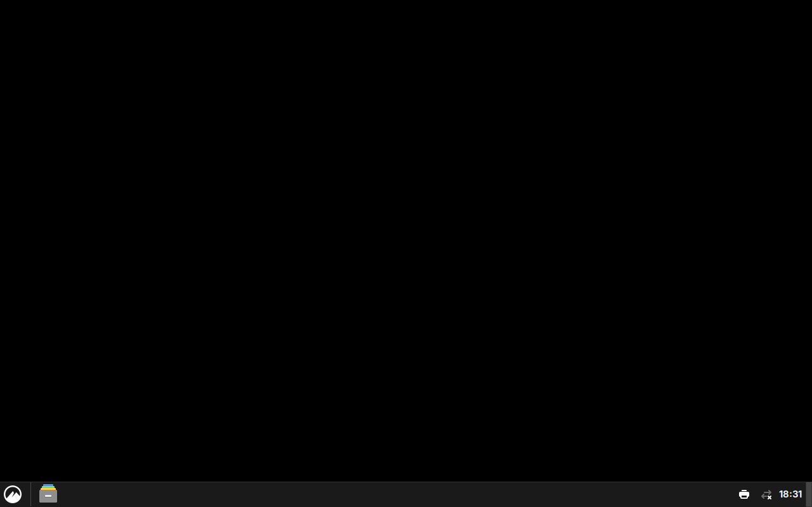

# Cinnamon Desktop AppImage

An [Anylinux AppImage](https://github.com/pkgforge-dev/Anylinux-AppImages) of the
[Cinnamon Desktop Environment](https://github.com/linuxmint/cinnamon), built with
[quick-sharun](https://github.com/pkgforge-dev/Anylinux-AppImages/blob/main/useful-tools/quick-sharun.sh).



**Status: works, with one caveat.** It starts a full Cinnamon X11 session:
Muffin composites, the panel loads with all 16 applets including the start
menu, and the whole `csd-*` settings-daemon set runs. The desktop-icons
component (`nemo-desktop`) does not start yet; see the note below.

It has only ever been tested in a headless sandbox with no user account, where
`nemo-desktop` segfaults because `getpwuid()` returns NULL. That is very likely
a sandbox artifact (a `getpwuid` stub makes it run fine), but it has not been
confirmed on a real desktop. Read [RESEARCH.md](RESEARCH.md) before relying on
this.

## Why this is not a normal AppImage

Cinnamon's dependency closure is 510 packages (~2.3 GiB installed), and unlike an
application it is not a single process:

- the session manager (`cinnamon-session`) resolves its components by reading
  `.desktop` files from `$XDG_DATA_DIRS/applications`, so those have to be
  bundled and their absolute `Exec=` paths rewritten;
- GObject-Introspection dlopens the library each typelib names, which `ldd`
  never sees, so ~10 libraries (`libibus`, `libkeybinder`, `libgsound`, …)
  have to be listed by hand;
- several components live in private lib dirs and are referenced by absolute
  path (`/usr/lib/cinnamon-session/...`, `/usr/lib/muffin/...`,
  `/usr/lib/cinnamon/...`, `/usr/share/cinnamon/...`), which needs both
  directory deployment and `PATH_MAPPING`;
- `cinnamon-session` itself is a shell script that execs a binary by absolute
  path, so it needs an override in `AppDir/bin`;
- the desktop icons (`nemo-desktop`) are a separate GApplication on the session
  bus;
- the start menu reads `/etc/xdg/menus` through `XDG_CONFIG_DIRS`, which
  defaults to the host's, so a hook has to prepend the AppDir.

The AppImage is ~200 MiB and 1136 shared objects.

## Building

Deploying on any system other than Arch Linux is a very bad idea. Cinnamon must
be installed to `/usr` before it is deployed, which is what
`get-dependencies.sh` does.

```sh
./get-dependencies.sh
./make-appimage.sh
```

The result is `dist/Cinnamon-x86_64.AppImage`.

## Running

From a display manager, or directly from an X session:

```sh
./Cinnamon-x86_64.AppImage
```

It needs a session bus; `start-cinnamon-session` creates a private one when
`DBUS_SESSION_BUS_ADDRESS` is unset. A system bus, logind, polkit, udev and the
rest still come from the host, so this is a portable *session*, not a portable
operating system.

## Credits

- Cinnamon, Muffin, Nemo, CJS: GPL-2.0-or-later, Linux Mint.
- [quick-sharun](https://github.com/pkgforge-dev/Anylinux-AppImages) and
  [sharun](https://github.com/VHSgunzo/sharun), from pkgforge-dev and VHSgunzo.
